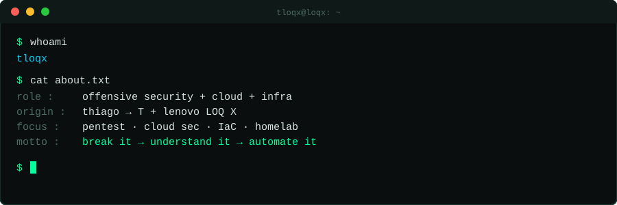

<p align="center">
  
</p>

<p align="center">
  <a href="https://git.io/typing-svg">
    
  </a>
</p>

<p align="center">
  <a href="https://www.linkedin.com/in/tpsousa-/"></a>
  <a href="mailto:tpsousa.eng@gmail.com"></a>
  <a href="https://portifolio-thiago-sousa.vercel.app/"></a>
  <!-- Descomente quando tiver conta:
  <a href="https://tryhackme.com/p/SEU_USER"></a>
  <a href="https://app.hackthebox.com/users/SEU_ID"></a>
  -->
</p>

<h3 align="center">// about</h3>

```bash
tloqx@loqx:~$ cat about.md

# Thiago → T + Lenovo LOQ X = tloqx
# O lado do meu perfil dedicado a segurança ofensiva, cloud e infraestrutura.

[focus]
  offensive security   -> pentest, CTFs, recon, exploitation (labs e ambientes autorizados)
  cloud security       -> AWS, IAM, misconfigs, hardening
  infra & automation   -> Linux, Docker, IaC, CI/CD, homelab

[now]
  studying   : <!-- ex: eJPT, AWS Security, Terraform -->
  building   : <!-- ex: homelab com AD + SIEM, scripts de recon -->
  playing    : <!-- ex: TryHackMe, HackTheBox, PortSwigger Academy -->
```

<h3 align="center">// stack</h3>

<p align="center">
  
</p>

<h3 align="center">// toolbox</h3>

<p align="center">
  
  
  
  
  
</p>

<h3 align="center">// github stats</h3>

<p align="center">
  
</p>

<p align="center">
  
  
</p>

<h3 align="center">// repos</h3>

<!-- Quando tiver projetos, fixe os 6 principais no perfil. Ideias:
  - recon-toolkit        (scripts de reconhecimento em bash/python)
  - homelab-iac          (Terraform + Ansible do seu lab)
  - aws-misconfig-lab    (ambiente vulnerável + writeup)
  - ctf-writeups         (resoluções de CTF/TryHackMe/HTB)
  - dotfiles             (seu setup de terminal)
-->

<p align="center">
  <sub>⚠️ Todo conteúdo aqui é para fins educacionais e uso em ambientes autorizados (labs, CTFs, bug bounty com escopo).</sub>
</p>

<p align="center">
  🔗 <a href="https://portifolio-thiago-sousa.vercel.app/">Portfólio</a>
  •
  <a href="https://www.linkedin.com/in/tpsousa-/">LinkedIn</a>
  •
  <a href="mailto:tpsousa.eng@gmail.com">tpsousa.eng@gmail.com</a>
</p>
